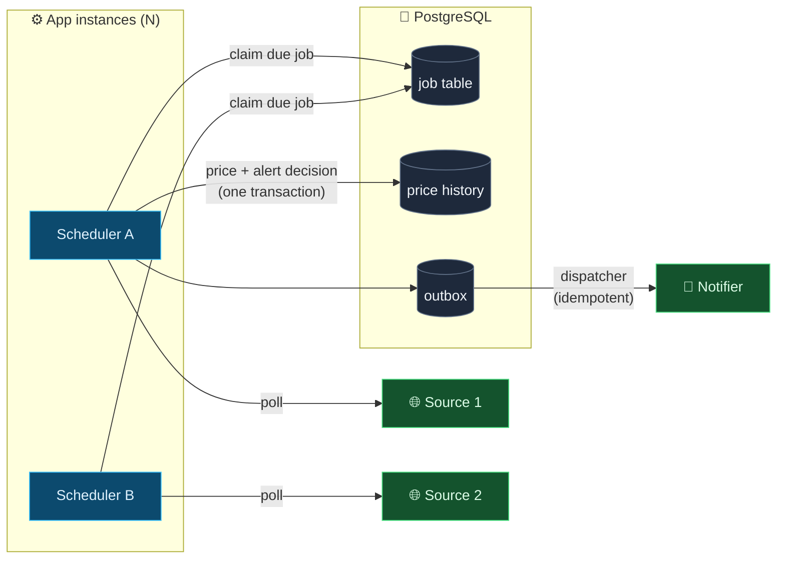
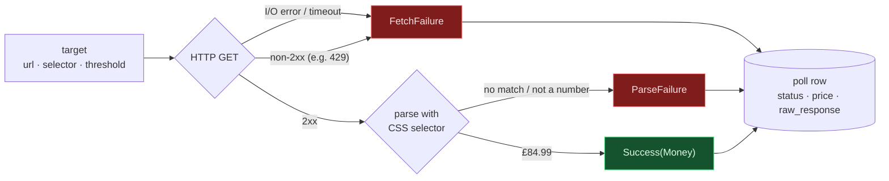
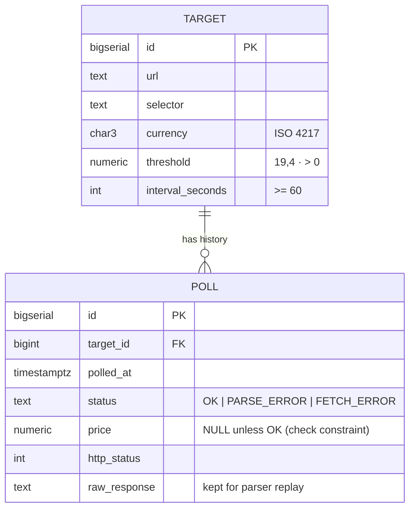
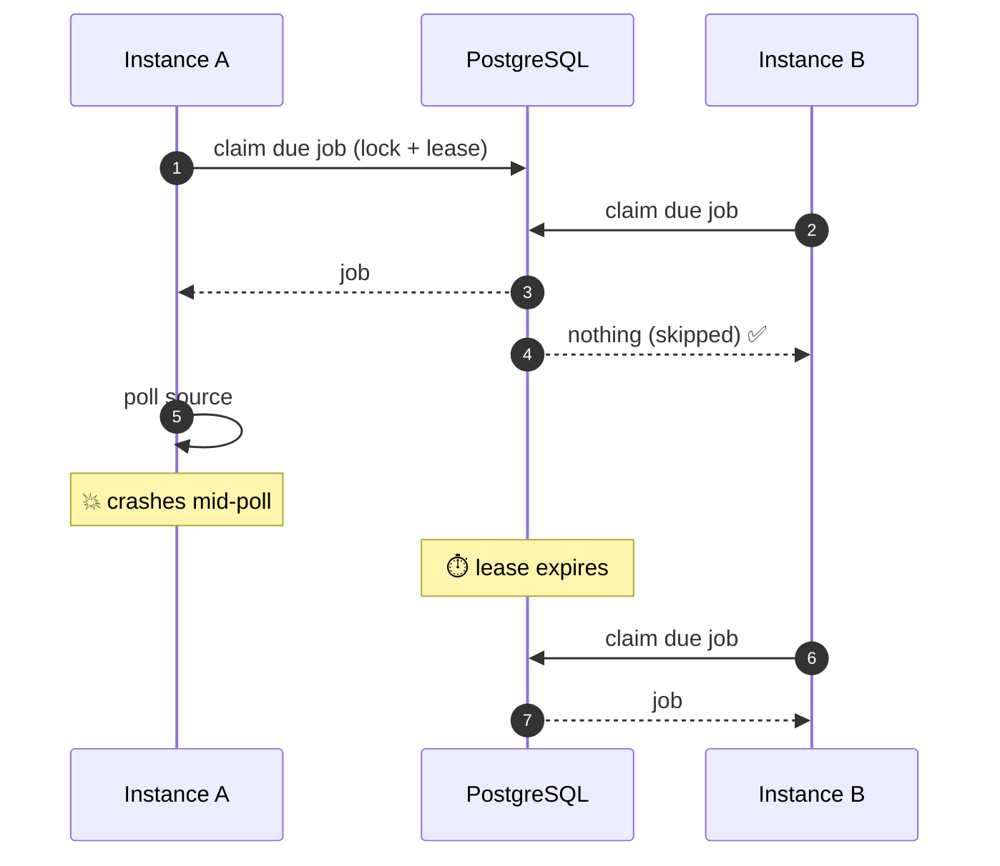
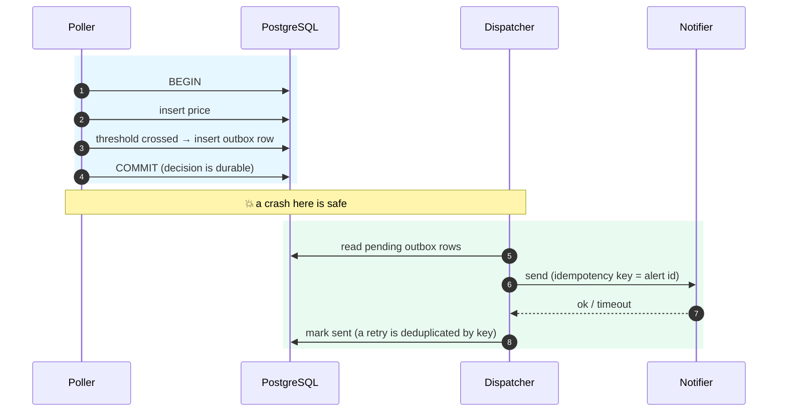
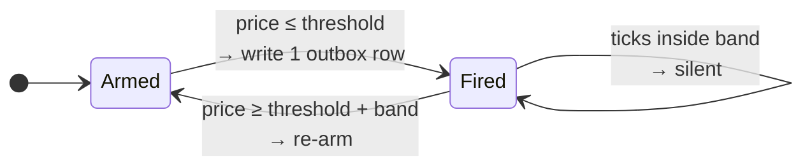

<div align="center">


<br>


**[Demo](#-see-it-run)** · **[Architecture](#-architecture)** · **[The hard parts](#-the-hard-parts)** · **[Proof](#-proof-not-promises)** · **[Quickstart](#-quickstart)** · **[Roadmap](#-roadmap)**

</div>

---

## 💡 What it is

Price Watch polls targets on independent schedules, stores a price time-series, and fires a notification when a threshold is crossed.

The prices are the boring part. What it's really about is **scheduling, concurrency control and delivery guarantees**. Think of it as a market-data alerting system with a slower clock: ingest prices, store the series, evaluate threshold rules, fire exactly once.

<table>
<tr>
<td width="33%" valign="top">

### 🔒 Exactly-once claiming
N instances share one job table. Every due job is polled by exactly one of them, and a job held by a dead instance is retried, not orphaned.

</td>
<td width="33%" valign="top">

### 📬 Exactly-once delivery
One threshold crossing gives one notification, through crashes, retries and duplicate evaluations. The tools are a transactional outbox and idempotency keys.

</td>
<td width="33%" valign="top">

### 🛡️ No false alerts
A parser that breaks returns an **error**, never a price of £0. The database rejects a failed poll that carries a price.

</td>
</tr>
</table>

---

## 📍 Where it stands

| | Milestone | What it proves | Progress |
|:-:|---|---|---|
| ✅ | **M0: Core loop** | Add, poll, store, read history; failures are errors | `██████████` done |
| ⏳ | **M1: Scheduling** | Per-target intervals, defined missed-poll behaviour | `░░░░░░░░░░` |
| ⏳ | **M2: Job claiming** | Double-claim reproduced, then fixed under load | `░░░░░░░░░░` |
| ⏳ | **M3: Exactly-once alerts** | Outbox; crash between decide and send | `░░░░░░░░░░` |
| ⏳ | **M4: Resilience** | Backoff on 429, circuit breaker, source isolation | `░░░░░░░░░░` |
| ⏳ | **M5: Real use** | A week unattended, zero false alerts | `░░░░░░░░░░` |

> [!NOTE]
> Everything below marked **✅ built** exists and is tested. Everything marked **🧭 design** is the plan for that milestone and isn't written yet.

---

## 🎬 See it run

This is real output, captured on 2026-10-21 from one instance polling a local page whose price drops from £84.99 to £77.49.

```console
$ curl -X POST localhost:8080/targets -H 'Content-Type: application/json' \
    -d '{"url":"http://127.0.0.1:9000/keyboard.html","selector":".price",
         "threshold":"79.99","currency":"GBP","intervalSeconds":900}'
{ "id": 1, "selector": ".price", "threshold": { "amount": 79.99, "currency": "GBP" }, "intervalSeconds": 900, ... }

$ curl -X POST localhost:8080/targets/1/poll          # price on page: £84.99
{ "id": 1, "status": "OK", "price": 84.99, "httpStatus": 200, "error": null, ... }

$ curl -X POST localhost:8080/targets/1/poll          # price drops to £77.49
{ "id": 2, "status": "OK", "price": 77.49, "httpStatus": 200, "error": null, ... }

$ curl -X POST localhost:8080/targets/2/poll          # target 2: selector ".price-v2" no longer matches
{ "id": 3, "status": "PARSE_ERROR", "price": null, "httpStatus": 200, "error": "no price at selector .price-v2", ... }
```

<details>
<summary><b>What landed in Postgres</b>: a failure is <code>NULL</code>, never <code>0</code>, and the raw page is kept</summary>

```console
$ psql -c "SELECT id, target_id, status, price, http_status, length(raw_response) AS raw_bytes FROM poll"
 id | target_id |   status    |  price  | http_status | raw_bytes
----+-----------+-------------+---------+-------------+-----------
  1 |         1 | OK          | 84.9900 |         200 |        88
  2 |         1 | OK          | 77.4900 |         200 |        88
  3 |         2 | PARSE_ERROR |         |         200 |        88
```

</details>

<details>
<summary><b>Application log</b></summary>

```text
12:29:13.395 INFO  [instance-a] d.p.poll.PollService - polled target=1 outcome=Success
12:29:13.440 INFO  [instance-a] d.p.poll.PollService - polled target=1 outcome=Success
12:29:13.496 INFO  [instance-a] d.p.poll.PollService - polled target=2 outcome=ParseFailure
```

</details>

<details>
<summary><b>Validation</b>: bad input is rejected at the door</summary>

```console
$ curl -X POST localhost:8080/targets -d '{"url":"ftp://x","threshold":"-1","intervalSeconds":5, ...}'
HTTP 400
```

</details>

> The second poll crossed the £79.99 threshold. In M0 that's only recorded. Turning it into **exactly one** notification is M3.

---

## 🏗️ Architecture



### ✅ Built: the poll pipeline (M0)

Each poll produces exactly one of three typed outcomes. None of them can be mistaken for a price of zero.



### ✅ Built: data model



---

## 🧠 The hard parts

### 1. Two instances, one due job: 🧭 design (M2)

Both instances wake at the same instant and see the same due job. Exactly one must win, and if the winner dies mid-poll the job must not be orphaned.



**The plan is to break it first, then fix it.** Claim naively at a weak isolation level, reproduce the double-claim under load, and record it:

<!-- TODO (M2): replace with the real log excerpt -->
```diff
  [instance-a] claimed job 42 (target=...)
- [instance-b] claimed job 42 (target=...)   <-- double claim
```

Then apply the fix and prove every job is claimed exactly once under the same load, against **real PostgreSQL via Testcontainers**. A mock can't reproduce a lost update, so a test against one proves nothing.

### 2. Deciding vs sending: 🧭 design (M3)

The alert decision is made in a database transaction. Sending is an external call that can't be rolled back. The **transactional outbox** makes the two effectively atomic:



### 3. No alert storms: 🧭 design (M3)

A price hovering around the threshold must not spam you. The proposed rule is to fire once, stay silent while the price stays near the threshold, and re-arm only once it clears a reset band:

<p align="center">
  
</p>



<!-- TODO (M3): confirm the band width once decided -->

---

## ✅ Proof, not promises

Each invariant is a test, not a comment. A ticked box has a test that passes today.

| | Invariant | Test | Milestone |
|:-:|---|---|:-:|
| ✅ | Broken selector → error, not £0 | `PriceParserTest`, `ManualPollIT` | M0 |
| ✅ | HTTP 429 → `FETCH_ERROR`, no price | `ManualPollIT` | M0 |
| ✅ | Price stored and history readable, against real Postgres | `ManualPollIT` | M0 |
| ✅ | Money: no float drift; `1.0 == 1.00`; no cross-currency compare | `MoneyTest` | M0 |
| ⬜ | Three targets on three intervals, observed over an hour | – | M1 |
| ⬜ | Two instances under load → each job claimed exactly once | – | M2 |
| ⬜ | Kill an instance mid-poll → job retried, not orphaned | – | M2 |
| ⬜ | Crash between decide and send → exactly one notification | – | M3 |
| ⬜ | Forced duplicate dispatch → recipient sees one alert | – | M3 |
| ⬜ | **One threshold crossing → one delivered notification, always** | – | M3 |
| ⬜ | 429s → backoff observed, other sources unaffected | – | M4 |
| ⬜ | 7 days unattended, zero false alerts | – | M5 |

| Metric | Result |
|---|---|
| Sustained polls / hour across N targets | *measured in M4* |
| Longest unattended run | *measured in M5* |
| False alerts | *measured in M5* |

---

## ⚖️ Design decisions

| Decision | Chosen | Why / trade-off |
|---|---|---|
| ✅ Money type | `BigDecimal`, scale 4 ↔ `NUMERIC(19,4)` | No float rounding. Comparisons use `compareTo`, because `equals` treats `1.0` and `1.00` as different |
| ✅ Parse failure | `PARSE_ERROR` row with `NULL` price | A `0` would satisfy every threshold and fire a false alert. A DB check constraint enforces this |
| ✅ Raw responses | Stored per poll | A silently broken parser can be detected and replayed |
| ✅ HTTP vs transactions | No transaction held across a fetch | Network latency must never hold DB locks |
| 🧭 Scheduler | *M1* | DB job table vs `@Scheduled`: which survives restarts and coordinates N nodes? |
| 🧭 Missed polls | *M1* | Skip or catch up after downtime? |
| 🧭 Claiming | *M2* | Row lock vs version column vs lease |
| 🧭 Isolation level | *M2* | Which anomaly it actually prevents |

Full schema reasoning is in [`docs/schema.md`](docs/schema.md).

---

## 🚀 Quickstart

Requires **Java 21+** and **Docker**.

**1. Start Postgres**

```bash
docker compose up -d postgres
```

**2. Run an instance** (migrations apply on startup)

```bash
./mvnw spring-boot:run
```

**3. Optionally, run a second instance alongside it**

```bash
SERVER_PORT=8081 INSTANCE_ID=instance-b ./mvnw spring-boot:run
```

**4. Run the full suite** (unit tests plus `*IT` integration tests against real Postgres in Testcontainers)

```bash
./mvnw verify
```

<details>
<summary><b>API reference</b></summary>

| Method | Path | Purpose |
|---|---|---|
| `POST` | `/targets` | Add a target: `url`, `selector`, `threshold`, `currency`, `intervalSeconds` (≥ 60) |
| `GET` | `/targets` | List targets |
| `GET` | `/targets/{id}` | One target |
| `POST` | `/targets/{id}/poll` | Poll now (M0; the scheduler takes over in M1) |
| `GET` | `/targets/{id}/history?limit=100` | Price history, newest first |
| `GET` | `/actuator/health` | Health check |

</details>

<details>
<summary><b>Configuration</b></summary>

| Env var | Default | Meaning |
|---|---|---|
| `DB_URL` | `jdbc:postgresql://localhost:5432/pricewatch` | JDBC URL |
| `DB_USER` / `DB_PASSWORD` | `pricewatch` | Credentials for the local compose database |
| `SERVER_PORT` | `8080` | HTTP port |
| `INSTANCE_ID` | random UUID | Shows in logs and, from M2, in job claims |

</details>

---

## 🗂️ Project layout

```
src/main/java/dev/pricewatch/
├── price/      ✅ Money, PriceParser
├── poll/       ✅ fetch → parse → store · PollOutcome (Success | ParseFailure | FetchFailure)
├── target/     ✅ REST API and repository
├── schedule/   🧭 M1
├── claim/      🧭 M2
├── alert/      🧭 M3
└── source/     🧭 M4
src/main/resources/db/migration/   Flyway migrations
src/test/java/…                    *Test = unit · *IT = Testcontainers
```

## 🧰 Stack

**Java 21** · **Spring Boot 3.3** (Web, JDBC `JdbcClient`, Validation, Actuator) · **PostgreSQL 16** · **Flyway** · **jsoup** · **Testcontainers** · **JUnit 5** · **AssertJ**

## 🛣️ Roadmap

- **v1:** M1 → M5 above. Two sources at most, public APIs preferred, `robots.txt` respected.
- **v2:** adaptive poll frequency (volatile targets polled more often), trend queries ("has this ever been cheaper?"), more notification channels, a UI beyond REST.
- **Out of scope:** matching products across retailers. One target is one URL is one price series.
