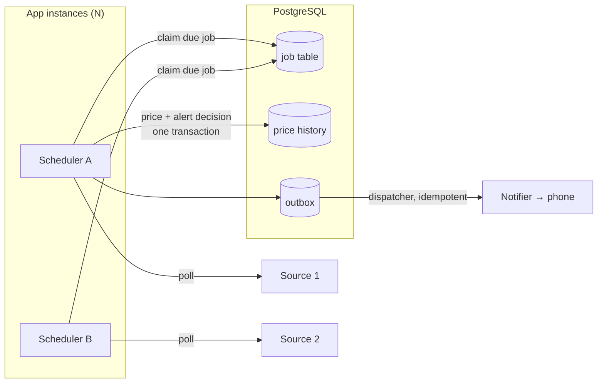
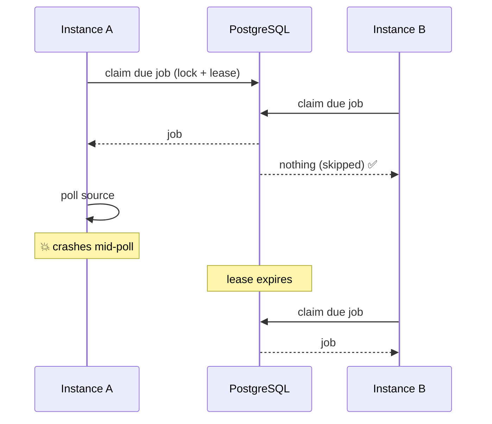
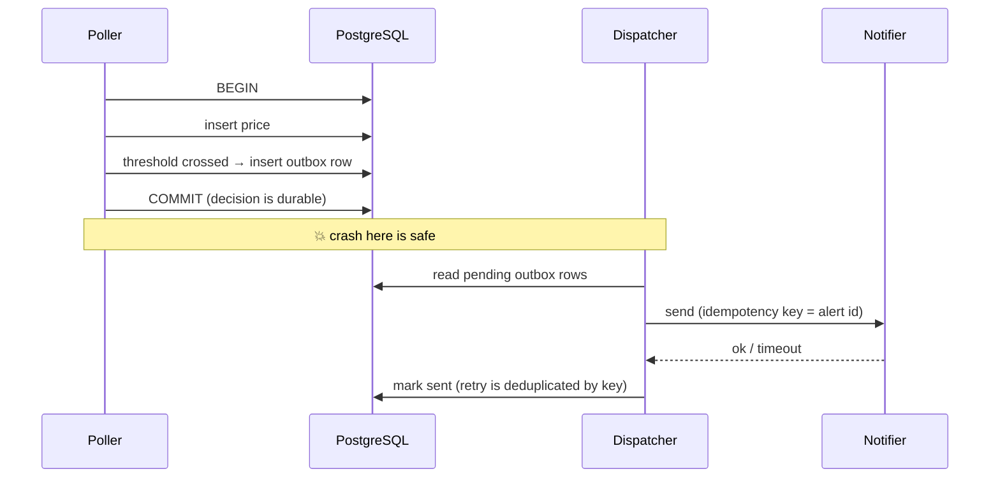
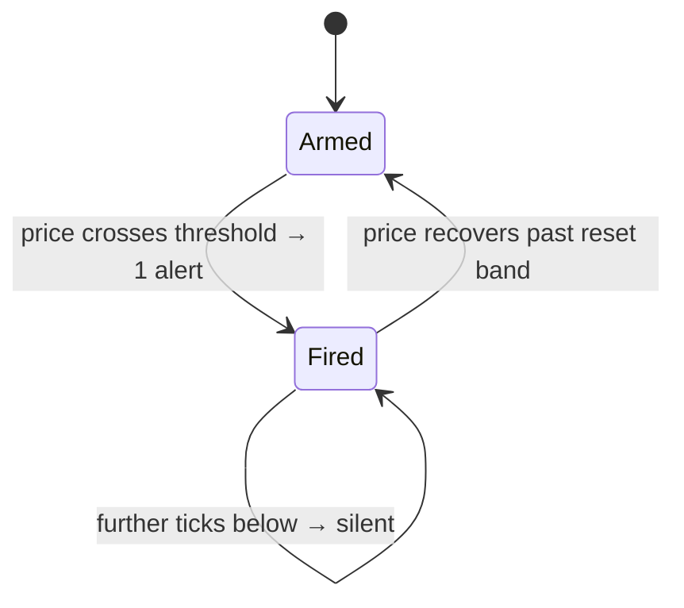

<div align="center">

# Price Watch

**A distributed scheduler that watches things and tells you once, exactly once, when something changes.**


<!-- TODO: record a demo and uncomment

-->

</div>

---

## What it is

Price Watch polls targets on independent schedules, stores a price time-series, and fires a notification when a threshold is crossed.

The interesting part is the guarantees, not the prices. It is a **market-data alerting system with a slower clock**:

| Guarantee | What it means | How it's enforced |
|---|---|---|
| **Exactly-once claiming** | Many instances, one job table, no job polled twice | <!-- TODO (M2): e.g. `FOR UPDATE SKIP LOCKED` + lease expiry --> *M2* |
| **Exactly-once delivery** | One threshold crossing = one notification, through crashes and retries | Transactional outbox + idempotency key *(M3)* |
| **Crash safety** | Kill any instance at any point, nothing lost or duplicated | Leases expire, outbox replays on restart *(M2–M3)* |
| **No false alerts** | A broken parser never reads as £0 | Parse failures are errors, never prices. Enforced by a DB check constraint ✅ |
| **Upstream isolation** | One failing source never slows the others | Per-source backoff + circuit breaker *(M4)* |

---

## Architecture



---

## The hard parts

### 1. Two instances, one due job

Both instances wake at the same instant and see the same due job. Exactly one must win, and if the winner dies mid-poll the job must not be orphaned.



**The plan is to reproduce the bug before fixing it.** Run at a weaker isolation level with no locking, get two instances to double-claim the same target under load, and record it:

<!-- TODO (M2): paste a real log excerpt or swap in docs/double-claim.gif -->
```text
[instance-a] claimed job 42 (target=...)
[instance-b] claimed job 42 (target=...)   <-- double claim
```

Then apply the fix and show every job claimed exactly once under the same load, against **real PostgreSQL via Testcontainers**. A mock can't reproduce a lost update, so testing against one would prove nothing.

### 2. Deciding vs sending

The alert decision is made in a database transaction, but sending is an external call that can't be rolled back. The **transactional outbox** makes the two effectively atomic:



### 3. No alert storms

A price oscillating around the threshold must not spam you:



<!-- TODO (M3): confirm this matches your re-arm rule (e.g. hysteresis band %) -->

---

## Proof, not promises

The invariants are tests, not comments. Ticked boxes have a passing test behind them.

- [x] Broken selector → error, not £0 (`PriceParserTest`, `ManualPollIT`)
- [ ] Three targets on three intervals, observed over an hour *(M1)*
- [ ] Two instances under load → each job claimed exactly once *(M2)*
- [ ] Kill an instance mid-poll → job retried, not orphaned *(M2)*
- [ ] Crash between decide and send → exactly one notification on restart *(M3)*
- [ ] Forced duplicate dispatch → recipient still sees one alert *(M3)*
- [ ] One threshold crossing → one delivered notification, **always** *(M3)*
- [ ] Source returning 429s → backoff, other sources unaffected *(M4)*
- [ ] 7 days unattended with zero false alerts *(M5)*

| Metric | Result |
|---|---|
| Sustained polls / hour across N targets | <!-- TODO (M4) --> – |
| Longest unattended run | <!-- TODO (M5) --> – |
| False alerts | <!-- TODO (M5) --> – |

---

## Design decisions

Full schema notes: [docs/schema.md](docs/schema.md).

| Decision | Chosen | Why / trade-off |
|---|---|---|
| Money type | `BigDecimal`, scale 4 ↔ `NUMERIC(19,4)` | No float rounding; compare with `compareTo`, not `equals` |
| Parse failure | `PARSE_ERROR` row, `NULL` price | A `0` would satisfy every threshold and fire a false alert |
| Raw responses | Stored per poll | Lets a silently broken parser be detected and replayed |
| HTTP vs transactions | No transaction held across a fetch | Network latency must never hold DB locks |
| Scheduler | <!-- TODO (M1) --> | <!-- TODO: e.g. DB job table survives restarts and coordinates N nodes; @Scheduled alone can't --> |
| Missed polls after downtime | <!-- TODO (M1): skip / catch up --> | <!-- TODO --> |
| Claiming | <!-- TODO (M2) --> | <!-- TODO: e.g. SKIP LOCKED avoids contention; lease handles dead instances --> |
| Isolation level | <!-- TODO (M2) --> | <!-- TODO: which anomaly it prevents --> |

---

## Run it

Requires Java 21+ and Docker.

```bash
docker compose up -d postgres
```

```bash
./mvnw spring-boot:run
```

```bash
SERVER_PORT=8081 INSTANCE_ID=b ./mvnw spring-boot:run
```

Tests: `./mvnw test` runs unit tests only; `./mvnw verify` also runs `*IT` integration tests against real Postgres in Testcontainers.

```bash
./mvnw verify
```

### API

```bash
# add a target
curl -X POST localhost:8080/targets \
  -H 'Content-Type: application/json' \
  -d '{"url": "https://example.com/item", "selector": ".price", "threshold": "49.99", "currency": "GBP", "intervalSeconds": 900}'

# poll it by hand (M0; the scheduler takes over in M1)
curl -X POST localhost:8080/targets/1/poll

# read the history
curl localhost:8080/targets/1/history
```

---

## Layout

```
src/main/java/dev/pricewatch/
├── price/      Money, PriceParser
├── poll/       fetch → parse → store, PollOutcome (Success | ParseFailure | FetchFailure)
├── target/     REST API and repository
├── schedule/   M1 (stub)
├── claim/      M2 (stub)
├── alert/      M3 (stub)
└── source/     M4 (stub)
```

## Stack

**Java 21 · Spring Boot 3 · PostgreSQL 16 · Flyway · Testcontainers · JUnit 5**

## Roadmap

| Milestone | Scope | Status |
|---|---|---|
| M0 | Core loop: add, poll by hand, store, read history | ✅ |
| M1 | Per-target scheduling, documented missed-poll behaviour | ⏳ |
| M2 | Concurrent job claiming across instances | ⏳ |
| M3 | Exactly-once alerting via outbox | ⏳ |
| M4 | Backoff, circuit breaker, source isolation | ⏳ |
| M5 | A week of real use | ⏳ |

After v1: adaptive polling, trend queries ("has this ever been cheaper?"), more notification channels, a UI.
