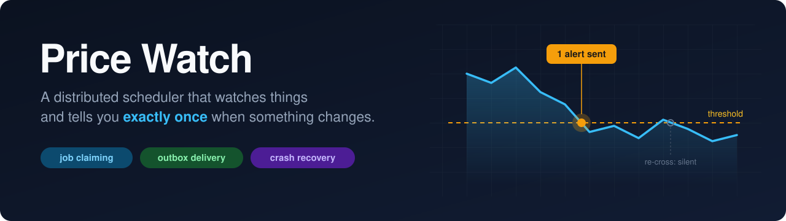
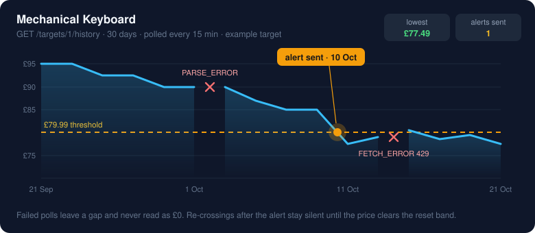
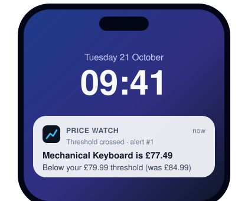
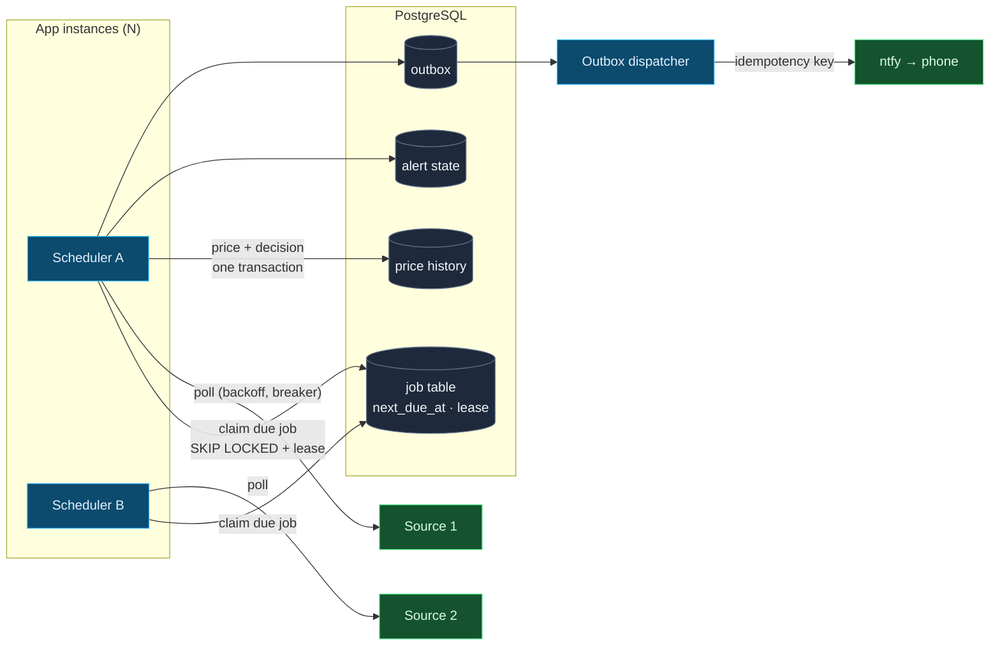
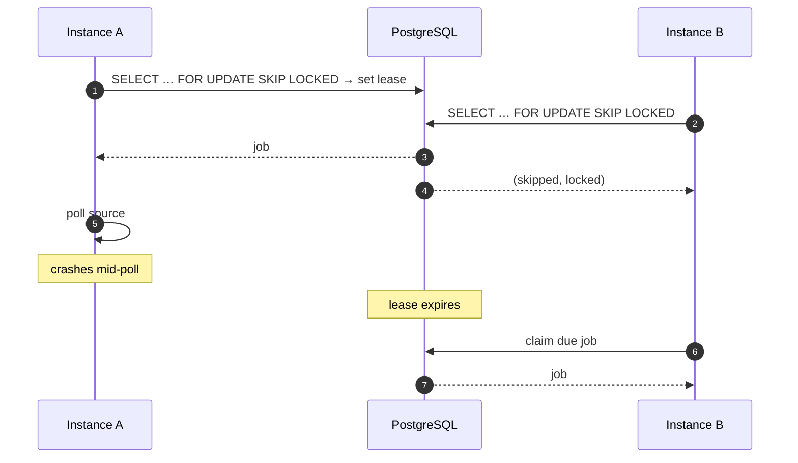
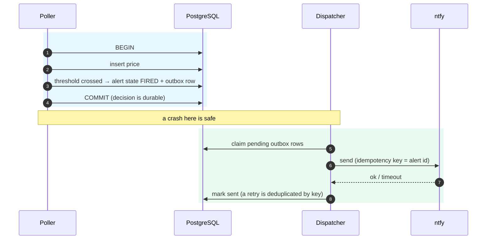
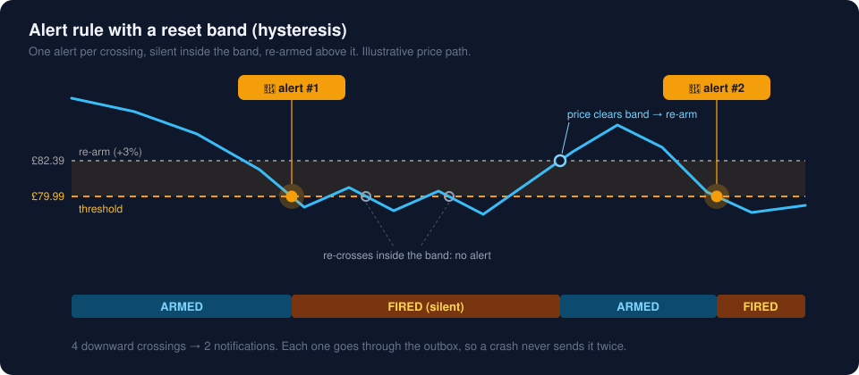
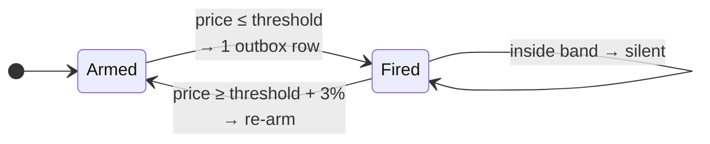
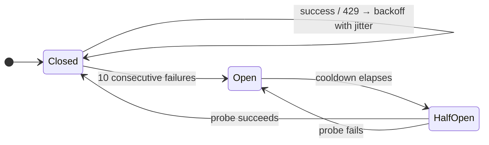
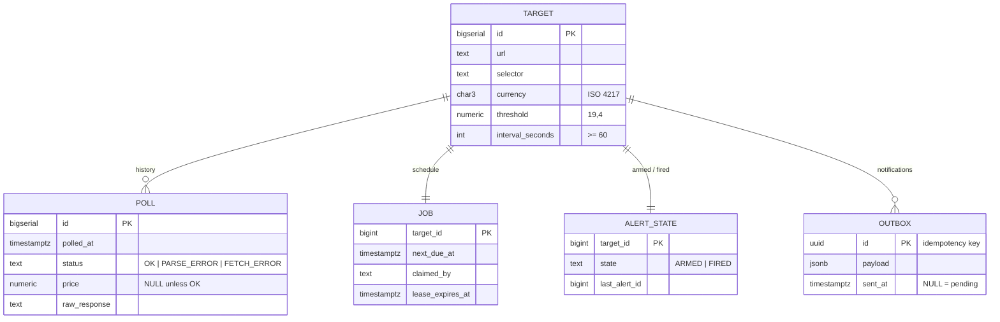

<div align="center">



<br>


**[How it works](#how-it-works)** · **[Features](#features)** · **[Quickstart](#quickstart)** · **[Under the hood](#under-the-hood)** · **[Guarantees](#guarantees-and-how-theyre-proven)** · **[API](#api)**

</div>

---

Price Watch watches the things you care about and pings your phone **once** when the price drops below your number. It doesn't send two pings, or a burst of them every time the price wobbles, and it doesn't fire a false alarm because a retailer redesigned their page.

Under the hood it's a **distributed job scheduler with exactly-once delivery**, essentially a market-data alerting system with a slower clock. Run one instance or five against the same Postgres: every target is polled on its own schedule by exactly one of them, and every threshold crossing produces exactly one notification, even if an instance is killed mid-flight.

<table>
<tr>
<td width="55%" valign="middle">

</td>
<td width="45%" valign="middle" align="center">

</td>
</tr>
<tr>
<td align="center"><sub>Every poll is stored. Failed polls are gaps, never £0.</sub></td>
<td align="center"><sub>One crossing, one notification.</sub></td>
</tr>
</table>

---

## How it works

**1. Point it at something**

```bash
curl -X POST localhost:8080/targets -H 'Content-Type: application/json' -d '{
  "url": "https://shop.example/keyboard",
  "selector": ".price",
  "threshold": "79.99",
  "currency": "GBP",
  "intervalSeconds": 900
}'
```

**2. It watches on its own schedule.** Each target has its own interval. Whichever instance is free claims the due poll, and no other instance can take it at the same time.

```json
{ "id": 2, "status": "OK",          "price": 77.49, "httpStatus": 200, "error": null }
{ "id": 3, "status": "PARSE_ERROR", "price": null,  "httpStatus": 200, "error": "no price at selector .price" }
```

**3. You hear about it once.** When the price drops below £79.99, a single push notification reaches your phone through [ntfy](https://ntfy.sh). If the price then wobbles around the threshold you get nothing more, until it climbs clear of a reset band and the alert re-arms.

---

## Features

<table>
<tr>
<td width="33%" valign="top">

**Per-target schedules**<br>
Each target polls on its own interval. The next due time is stored, not computed, so it survives restarts. Polls missed during downtime are collapsed into one catch-up poll, not replayed one by one.

</td>
<td width="33%" valign="top">

**Horizontal scaling**<br>
Add instances to add throughput. Instances claim jobs with `FOR UPDATE SKIP LOCKED` and a lease, so they never contend for or duplicate work.

</td>
<td width="33%" valign="top">

**Crash-safe claiming**<br>
Kill an instance mid-poll and its lease expires. Another instance picks the job up, so nothing is orphaned or claimed forever.

</td>
</tr>
<tr>
<td valign="top">

**Exactly-once alerts**<br>
The alert decision and the price commit together in one transaction. A transactional outbox and an idempotency key turn that decision into exactly one delivered notification.

</td>
<td valign="top">

**No alert storms**<br>
A reset band (hysteresis) means a price hovering around the threshold produces one alert, not twenty.

</td>
<td valign="top">

**No false alarms**<br>
A broken selector is a `PARSE_ERROR` with a `NULL` price, enforced by a database constraint. Raw responses are kept so broken parsers can be found and re-run.

</td>
</tr>
<tr>
<td valign="top">

**Polite to upstreams**<br>
It respects `robots.txt` and backs off exponentially, with jitter, on `429`. A per-source circuit breaker stops it hammering a source that's down.

</td>
<td valign="top">

**Source isolation**<br>
Each source has its own worker pool and breaker. One slow or blocked source never delays the others.

</td>
<td valign="top">

**Exact money**<br>
Prices are `BigDecimal` ↔ `NUMERIC(19,4)`, compared with `compareTo`. There's no floating point anywhere.

</td>
</tr>
</table>

---

## Quickstart

Requires **Java 21+** and **Docker**.

**1. Start Postgres**

```bash
docker compose up -d postgres
```

**2. Pick an ntfy topic** and subscribe to it in the ntfy app on your phone

```bash
export NTFY_TOPIC=pricewatch-$(openssl rand -hex 4)
```

**3. Start an instance**

```bash
./mvnw spring-boot:run
```

**4. Start a second instance.** It shares the job table and splits the work automatically.

```bash
SERVER_PORT=8081 INSTANCE_ID=instance-b ./mvnw spring-boot:run
```

**5. Run the full suite** (unit tests plus integration tests against real Postgres in Testcontainers)

```bash
./mvnw verify
```

---

## Architecture



| Component | Responsibility |
|---|---|
| **Scheduler** | Claims due jobs in batches; renews leases while polling; sets the next due time on completion |
| **Poller** | Fetches the page, parses the price, and returns a typed outcome: `Success`, `ParseFailure` or `FetchFailure` |
| **Evaluator** | In the same transaction as the price insert: checks the threshold, updates alert state, writes an outbox row |
| **Dispatcher** | Drains the outbox and sends with an idempotency key; retries are safe |
| **Source guard** | Per-source rate limit, backoff and circuit breaker |

---

## Under the hood

### 1. Two instances, one due job

Both instances wake at the same instant and see the same due job. Exactly one wins. If the winner dies mid-poll, its lease expires and the job comes back.



The bug was reproduced before it was fixed. With naive claiming at `READ COMMITTED` and no locking, two instances double-claimed the same job under load:

<!-- TODO: paste the real log excerpt from the M2 reproduction -->
```diff
  [instance-a] claimed job 42 (target=7)
- [instance-b] claimed job 42 (target=7)   <-- double claim
```

After the fix, the same load test shows each job claimed exactly once. It runs against **real PostgreSQL via Testcontainers**, because a mock can't reproduce a lost update.

### 2. Deciding vs sending

Sending a notification is an external call that can't be rolled back, so it never happens inside the transaction. The transaction only records the *intent*:



### 3. No alert storms

<p align="center">
  
</p>



### 4. Upstream resilience



Each source has its own breaker and worker pool, so an open breaker on one source has no effect on the others.

### Data model



---

## Guarantees and how they're proven

Every guarantee is an automated test against real Postgres, not a comment.

| Guarantee | Test |
|---|---|
| A broken selector is an error, never £0 | `PriceParserTest`, `ManualPollIT` |
| Three targets on three intervals each fire on time | `SchedulingIT` |
| Two instances under load → each job claimed exactly once | `ConcurrentClaimIT` |
| Instance killed mid-poll → job retried, not orphaned | `LeaseExpiryIT` |
| Crash between deciding and sending → exactly one notification | `OutboxCrashIT` |
| Forced duplicate dispatch → recipient sees one alert | `IdempotentDispatchIT` |
| Oscillating price → no storm | `HysteresisTest` |
| **One crossing → one delivered notification, always** | `ExactlyOnceInvariantTest` (property-based, randomised crashes) |
| 429s → backoff; other sources unaffected | `SourceIsolationIT` |
| Persistently failing source → circuit opens | `CircuitBreakerIT` |

### In production

<!-- Fill these in from real runs; don't estimate. -->
| Metric | Result |
|---|---|
| Sustained polls / hour across N targets, no rate limits tripped | TBD |
| Longest unattended run | TBD |
| False alerts over that run | TBD |

---

## Design decisions

| Decision | Chosen | Why |
|---|---|---|
| Money | `BigDecimal` scale 4 ↔ `NUMERIC(19,4)` | No float drift; `compareTo`, because `equals` treats `1.0` and `1.00` as different |
| Parse failure | `PARSE_ERROR` + `NULL` price, enforced by a check constraint | A `0` would satisfy every threshold |
| Raw responses | Stored per poll | Find and replay silently broken parsers |
| Scheduler | DB-backed job table | Survives restarts and coordinates N nodes, which Spring's `@Scheduled` alone can't |
| Next due time | Stored | Survives restarts; one indexed range scan finds due work |
| Missed polls | Collapsed into one catch-up poll | Stale polls are worthless; replaying them would hammer the source |
| Claiming | `FOR UPDATE SKIP LOCKED` + lease | No contention between instances; the lease recovers dead instances |
| Isolation | `READ COMMITTED` + row locks | Row locks prevent the lost update; no need for `SERIALIZABLE` retries |
| Network vs transactions | No transaction held across a fetch | Latency never holds locks |
| Delivery | Outbox + idempotency key | The only way to make "decide" and "send" effectively atomic |
| Re-arming | Hysteresis band (3%) | One alert per real drop, not per wobble |

Schema reasoning is in [`docs/schema.md`](docs/schema.md).

---

## API

| Method | Path | Purpose |
|---|---|---|
| `POST` | `/targets` | Add a target: `url`, `selector`, `threshold`, `currency`, `intervalSeconds` (≥ 60) |
| `GET` | `/targets` | List targets with current alert state |
| `GET` | `/targets/{id}` | One target |
| `DELETE` | `/targets/{id}` | Stop watching |
| `POST` | `/targets/{id}/poll` | Poll now, outside the schedule |
| `GET` | `/targets/{id}/history?limit=100` | Price history, newest first |
| `GET` | `/targets/{id}/alerts` | Notifications sent for this target |
| `GET` | `/actuator/health` | Health check |

<details>
<summary><b>Configuration</b></summary>

| Env var | Default | Meaning |
|---|---|---|
| `DB_URL` | `jdbc:postgresql://localhost:5432/pricewatch` | JDBC URL |
| `DB_USER` / `DB_PASSWORD` | `pricewatch` | Credentials for the local compose database |
| `SERVER_PORT` | `8080` | HTTP port |
| `INSTANCE_ID` | random UUID | Shown in logs and written to job claims |
| `NTFY_TOPIC` | (none) | ntfy topic that notifications go to |
| `PRICEWATCH_CLAIM_BATCH` | `10` | Jobs claimed per scheduler tick |
| `PRICEWATCH_LEASE` | `2m` | How long a claim lasts before another instance may retry it |
| `PRICEWATCH_RESET_BAND` | `0.03` | Price must rise this far above the threshold to re-arm |
| `PRICEWATCH_BREAKER_FAILURES` | `10` | Consecutive failures before a source's circuit opens |

</details>

---

## Project layout

```
src/main/java/dev/pricewatch/
├── target/     REST API and repository
├── schedule/   job table, due-job polling, next-due calculation
├── claim/      SKIP LOCKED claiming, leases, lease renewal
├── poll/       fetch → parse → store · PollOutcome
├── price/      Money, PriceParser
├── alert/      threshold evaluation, hysteresis, outbox, dispatcher
└── source/     per-source backoff, circuit breaker, robots.txt
src/main/resources/db/migration/   Flyway migrations
src/test/java/…                    *Test = unit · *IT = Testcontainers
```

## Stack

**Java 21** · **Spring Boot 3.3** (Web, JDBC `JdbcClient`, Validation, Actuator) · **PostgreSQL 16** · **Flyway** · **jsoup** · **ntfy** · **Testcontainers** · **JUnit 5** · **AssertJ**

## Roadmap

- Adaptive polling, so volatile targets are polled more often
- Trend queries ("has this ever been cheaper?")
- More notification channels
- A UI beyond REST

**Out of scope:** matching products across retailers. One target is one URL is one price series.
